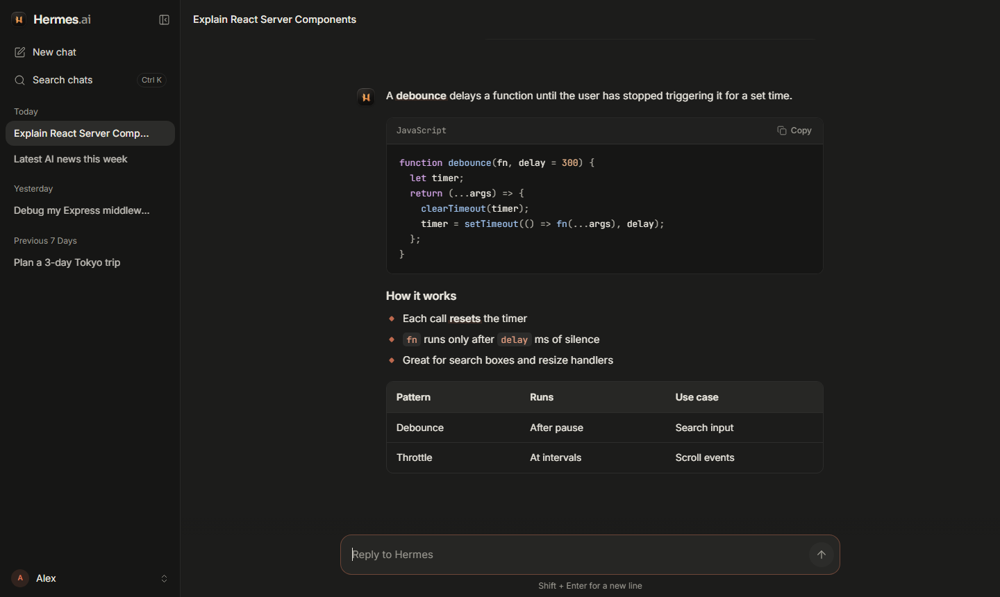
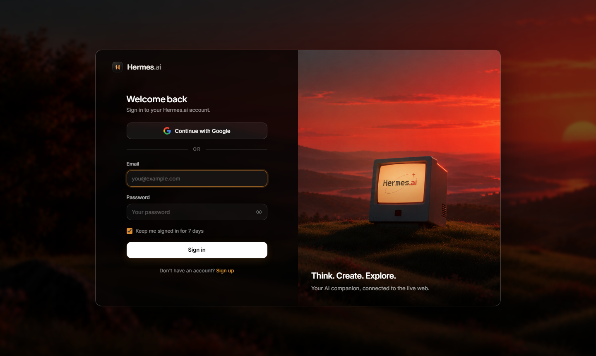
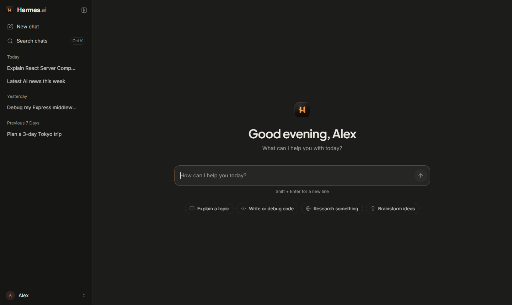
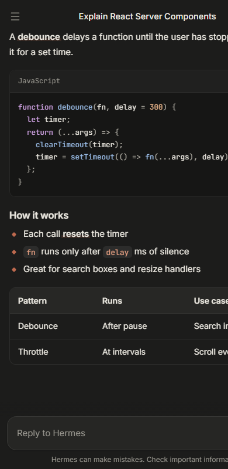

<div align="center">

# Hermes.ai

**A full-stack AI chat assistant that streams answers in real time and can search the live web.**

Think. Create. Explore.




</div>

---

## Table of contents

- [What is Hermes.ai?](#what-is-hermesai)
- [Screenshots](#screenshots)
- [Features](#features)
- [Tech stack](#tech-stack)
- [How it works](#how-it-works)
- [Project structure](#project-structure)
- [Getting started](#getting-started)
- [Environment variables](#environment-variables)
- [API reference](#api-reference)
- [Real-time events](#real-time-events)
- [Keyboard shortcuts](#keyboard-shortcuts)
- [Deployment](#deployment)

## What is Hermes.ai?

Hermes.ai is a ChatGPT-style web app. You sign up, verify your email (or use Google sign-in), and chat with an AI assistant. Answers appear token by token as they are generated. When a question needs fresh information (news, prices, recent events), the AI decides on its own to search the internet and answers using what it finds. Every conversation is saved to your account, so you can come back to it later.

## Screenshots

| Sign in | Sign up |
|---|---|
|  |  |

| Home / empty state | Mobile layout |
|---|---|
|  |  |

> Screenshots use sample data. Conversation content depends on your own account.

## Features

**Chat**
- Real-time streaming responses over WebSockets
- Live web search through an AI agent, with a "searching" status shown while it works
- Stop a response mid-generation, or regenerate the last answer
- Like / dislike AI messages
- Markdown rendering with syntax-highlighted code blocks (with a Copy button), tables, task lists and LaTeX math
- Auto-generated chat titles; rename or delete chats at any time
- Chats grouped by Today / Yesterday / Previous 7 Days / older
- Deep links to conversations (`/c/:chatId`) that survive a refresh

**Accounts and security**
- Email + password registration with email verification (sent via the Brevo API)
- "Continue with Google" sign-in (optional)
- JWT stored in an HTTP-only cookie, with a "keep me signed in for 7 days" option
- Passwords hashed with bcrypt; request validation with express-validator
- Every chat and message is scoped to its owner

**Interface**
- Responsive layout for desktop and mobile
- Command palette (`Ctrl/Cmd + K`) to search chats by title and content
- Theme switcher, settings dialog, toasts, collapsible sidebar

## Tech stack

| Layer | Technology |
|---|---|
| Frontend | React 19, Vite, Redux Toolkit, React Router, Tailwind CSS 4, Axios, socket.io-client, react-markdown (remark-gfm, remark-math, rehype-katex), react-syntax-highlighter, lucide-react |
| Backend | Node.js (ES modules), Express 5, Socket.IO, Mongoose, JWT, bcryptjs, express-validator, morgan |
| AI | LangChain agent, Google Gemini (main chat model), Mistral (title generation), Tavily (web search tool), Zod |
| Email / auth | Brevo transactional email API, Google OAuth (`google-auth-library`) |
| Database | MongoDB |

## How it works

```
 Browser (React) ──HTTP──▶ Express API ──▶ MongoDB   (users, chats, messages)
      ▲  │                      │
      │  └──── WebSocket ◀──────┤
      │      ai-chunk events    ▼
      └──────────────── LangChain agent ──▶ Gemini
                                   └─ searchInternet tool ──▶ Tavily
```

1. The user sends a message with `POST /api/chats/message` along with their Socket.IO socket id.
2. The server saves the message, replies `202 Accepted` right away and starts the AI agent in the background.
3. As Gemini generates text, the server pushes `ai-chunk` events to that user's socket. If the agent calls the search tool, an `ai-status` event is sent first.
4. When finished, the full answer is saved and `ai-complete` is emitted. A failure emits `ai-error`.
5. The client can emit `stop-generation` to abort an in-progress answer.
6. In production the Express server also serves the built React app, so the whole project runs as a single service.

## Project structure

```
Hermes AI/
├── package.json              # Root build/start scripts (used for deployment)
├── Backend/
│   ├── server.js             # Entry point: DB connect, HTTP + Socket.IO
│   ├── .env.example          # Template for environment variables
│   └── src/
│       ├── app.js            # Express app, middleware, serves Frontend/dist
│       ├── config/           # MongoDB connection
│       ├── controllers/      # auth.controller.js, chat.controller.js
│       ├── middlewares/      # JWT auth middleware
│       ├── models/           # user, chat, message (Mongoose)
│       ├── routes/           # auth.routes.js, chat.routes.js
│       ├── services/         # ai.service.js, internet.service.js, mail.service.js
│       ├── sockets/          # Socket.IO server and stop-generation handling
│       └── validators/       # express-validator rules
└── Frontend/
    ├── index.html
    └── src/
        ├── app/              # App shell, router, Redux store, Markdown renderer, global CSS
        └── features/
            ├── auth/         # Login, Register, VerifyEmail, Google button, auth slice/hooks
            ├── chat/         # Dashboard, sidebar, composer, message list, chat slice/hooks, socket client
            └── ui/           # Shared components: Dialog, Menu, Toaster, Avatar, Logo, theme hooks
```

## Getting started

### Prerequisites

- Node.js 20+ and npm
- A MongoDB database (local or [MongoDB Atlas](https://www.mongodb.com/atlas))
- API keys: [Google Gemini](https://aistudio.google.com/), [Mistral](https://console.mistral.ai/), [Tavily](https://tavily.com/)
- A free [Brevo](https://www.brevo.com/) account with an API key and a verified sender address (for verification emails) and, optionally, a Google OAuth client for Google sign-in

### 1. Clone and install

```bash
git clone <your-repo-url>
cd "Hermes AI"
npm install --prefix Backend
npm install --prefix Frontend
```

### 2. Configure the backend

```bash
cp Backend/.env.example Backend/.env
```

Fill in `Backend/.env` (see [Environment variables](#environment-variables)).

### 3. Run in development

Start the API (port 3000):

```bash
cd Backend
npm run dev
```

In a second terminal start the frontend (port 5173):

```bash
cd Frontend
npm run dev
```

Open http://localhost:5173. In development the frontend talks to the API at `http://localhost:3000`, so set `FRONTEND_URL=http://localhost:5173` in `Backend/.env` to allow CORS and make the email verification link point to the right place.

### 4. Production build (single server)

```bash
npm run build   # installs deps and builds Frontend/dist
npm start       # starts the backend, which also serves Frontend/dist
```

Open http://localhost:3000 (set `FRONTEND_URL` to your public URL).

## Environment variables

Defined in `Backend/.env` (template: [`Backend/.env.example`](Backend/.env.example)). Never commit real values.

| Variable | Required | Description |
|---|---|---|
| `PORT` | no | Server port (default `3000`) |
| `MONGO_URI` | yes | MongoDB connection string |
| `JWT_SECRET` | yes | Secret used to sign login tokens |
| `FRONTEND_URL` | yes | Public URL of the app (CORS and verification link) |
| `NODE_ENV` | no | Set to `production` to mark the auth cookie `Secure` |
| `GEMINI_API_KEY` | yes | Main chat model |
| `MISTRAL_API_KEY` | yes | Chat title generation |
| `TAVILY_API_KEY` | yes | Internet search tool |
| `BREVO_API_KEY` | yes | Brevo API key used to send verification emails |
| `MAIL_FROM` | yes | Sender address verified in Brevo |
| `GOOGLE_OAUTH_CLIENT_ID` | no | Enables "Continue with Google" |
| `GOOGLE_OAUTH_CLIENT_SECRET` | no | Enables the custom Google button with server-side code exchange |

## API reference

All endpoints are prefixed with `/api`. Chat routes require the auth cookie.

**Auth** (`/api/auth`)

| Method | Endpoint | Description |
|---|---|---|
| POST | `/register` | Create an account and send a verification email |
| POST | `/login` | Sign in (email must be verified) |
| GET | `/get-me` | Current user (protected) |
| GET | `/verify-email?token=` | Verify an email address |
| POST | `/logout` | Clear the auth cookie |
| GET | `/google/config` | Public Google client ID, if configured |
| POST | `/google` | Sign in or sign up with Google |

**Chats** (`/api/chats`, protected)

| Method | Endpoint | Description |
|---|---|---|
| POST | `/message` | Send a message; the AI answer streams over the socket |
| GET | `/` | List your chats |
| GET | `/:chatId/messages` | Messages of a chat |
| PATCH | `/:chatId` | Rename a chat `{ title }` |
| DELETE | `/delete/:chatId` | Delete a chat |
| POST | `/:chatId/regenerate` | Regenerate the last AI response |
| PATCH | `/:chatId/messages/:messageId/feedback` | Like or dislike a message |

## Real-time events

| Event | Direction | Purpose |
|---|---|---|
| `ai-status` | server → client | The AI started a web search |
| `ai-chunk` | server → client | A piece of the streaming answer |
| `ai-complete` | server → client | Answer finished (or was stopped) |
| `ai-error` | server → client | Generation failed |
| `stop-generation` | client → server | Abort the current answer for a chat |

## Keyboard shortcuts

Use `Cmd` instead of `Ctrl` on macOS.

| Shortcut | Action |
|---|---|
| `Ctrl + Shift + O` | New chat |
| `Ctrl + K` | Search chats |
| `Ctrl + B` | Toggle sidebar |
| `/` | Focus the message box |
| `Enter` / `Shift + Enter` | Send / new line |
| `Esc` | Stop generating (in the message box) |

## Deployment

The root `package.json` is set up for platforms like Render: the build command installs dependencies and builds the frontend, and the start command runs the backend, which serves the built app and the API from one URL. Set all environment variables in your host's dashboard, and set `NODE_ENV=production` and `FRONTEND_URL` to your public URL.

---

<div align="center">Built with care. If you find Hermes.ai useful, give it a star.</div>
