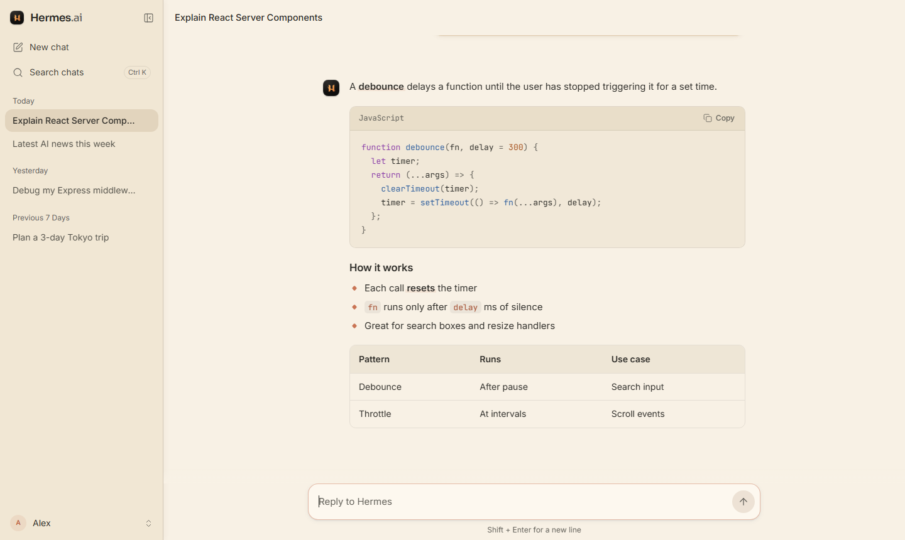
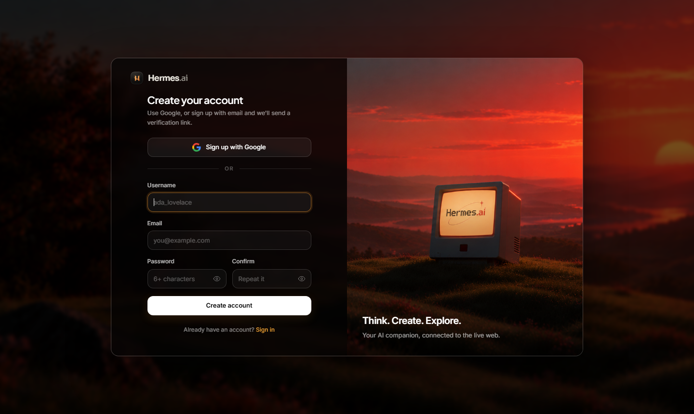
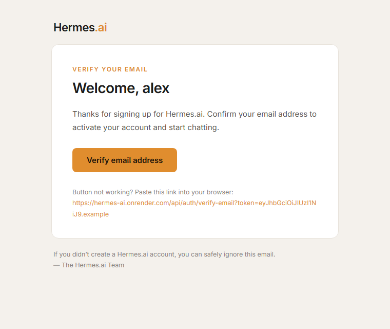
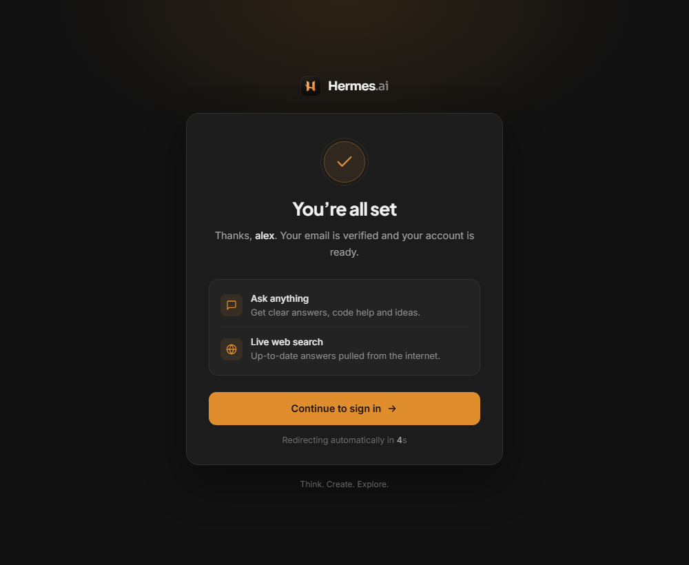

<div align="center">

# Hermes.ai

**An AI chat assistant that streams answers in real time and searches the live web when it needs fresh information.**


</div>

---

## Contents

1. [Overview](#1-overview)
2. [Screenshots](#2-screenshots)
3. [Features](#3-features)
4. [Tech stack](#4-tech-stack)
5. [How it works](#5-how-it-works)
6. [Project structure](#6-project-structure)
7. [Getting started](#7-getting-started)
8. [Environment variables](#8-environment-variables)
9. [Setting up third-party services](#9-setting-up-third-party-services)
10. [API reference](#10-api-reference)
11. [Real-time events](#11-real-time-events)
12. [Keyboard shortcuts](#12-keyboard-shortcuts)
13. [Deployment](#13-deployment)
14. [Troubleshooting](#14-troubleshooting)

---

## 1. Overview

Hermes.ai is a ChatGPT-style web app. A user signs up (with email or Google), verifies their email, and chats with an AI assistant. Answers appear word by word as they are generated. When a question needs current information such as news or prices, the AI decides on its own to search the internet and answers from what it finds. Every conversation is saved to the user's account.

**In short:** React frontend + Express API + MongoDB + a LangChain agent (Gemini) with a web-search tool, connected by WebSockets for streaming.

## 2. Screenshots

### Chat

| Dark | Light |
|---|---|
|  |  |

### Home and mobile

| New chat screen | Mobile |
|---|---|
|  |  |

### Sign in and sign up

| Sign in | Sign up |
|---|---|
|  |  |

### Email verification

| Verification email | After clicking the link |
|---|---|
|  |  |

> Screenshots use sample data.

## 3. Features

**Chat**
- Real-time streaming responses over WebSockets
- Live web search through an AI agent, with a "searching" status while it works
- Stop a response mid-way, or regenerate the last answer
- Like or dislike AI messages
- Markdown with syntax-highlighted code blocks (Copy button), tables, task lists and LaTeX math
- Auto-generated chat titles; rename or delete chats at any time
- Chats grouped by Today, Yesterday, Previous 7 Days and older
- Direct links to conversations (`/c/:chatId`) that survive a refresh

**Accounts and security**
- Email and password sign-up with email verification
- "Continue with Google" sign-in (optional)
- JWT in an HTTP-only cookie, with a "keep me signed in for 7 days" option
- Passwords hashed with bcrypt; inputs validated with express-validator
- Every chat and message is scoped to its owner

**Interface**
- Responsive layout for desktop and mobile
- Dark and light themes
- Command palette (`Ctrl/Cmd + K`) that searches chat titles and content
- Collapsible sidebar, settings dialog, toast notifications
- Designed verification email and "email verified" page

## 4. Tech stack

| Layer | Technology |
|---|---|
| Frontend | React 19, Vite, Redux Toolkit, React Router, Tailwind CSS 4, Axios, socket.io-client, react-markdown (remark-gfm, remark-math, rehype-katex), react-syntax-highlighter, lucide-react |
| Backend | Node.js (ES modules), Express 5, Socket.IO, Mongoose, JWT, bcryptjs, express-validator, morgan |
| AI | LangChain agent, Google Gemini (answers), Mistral (chat titles), Tavily (web search tool), Zod |
| Email | Brevo transactional email API |
| Auth | Email and password, Google OAuth (`google-auth-library`) |
| Database | MongoDB |

## 5. How it works

```
 Browser (React) ──HTTP──▶ Express API ──▶ MongoDB   (users, chats, messages)
      ▲  │                      │
      │  └──── WebSocket ◀──────┤
      │      ai-chunk events    ▼
      └──────────────── LangChain agent ──▶ Gemini
                                   └─ searchInternet tool ──▶ Tavily
```

1. The user sends a message with `POST /api/chats/message`, along with their Socket.IO socket id.
2. The server saves the message, replies `202 Accepted` immediately and runs the AI agent in the background.
3. As Gemini generates text, the server pushes `ai-chunk` events to that user's socket. If the agent calls the search tool, an `ai-status` event is sent first.
4. When done, the full answer is saved and `ai-complete` is emitted. A failure emits `ai-error`.
5. The client can emit `stop-generation` to cancel an answer in progress.
6. In production the Express server also serves the built React app, so everything runs as one service.

**Sign-up flow:** register, the server creates the user and sends a verification email through Brevo (if sending fails, the account is removed so the user can retry), the user clicks the link, the account is marked verified, and the user can sign in. Google sign-in skips the email step because Google has already verified the address.

## 6. Project structure

```
Hermes AI/
├── package.json                  Root build/start scripts (used for deployment)
├── docs/screenshots/             Images used in this README
├── Backend/
│   ├── server.js                 Entry point: database, HTTP server, Socket.IO
│   ├── .env.example              Template for environment variables
│   └── src/
│       ├── app.js                Express app, middleware, serves Frontend/dist
│       ├── config/               MongoDB connection
│       ├── controllers/          auth.controller.js, chat.controller.js
│       ├── middlewares/          JWT auth middleware
│       ├── models/               user, chat, message (Mongoose)
│       ├── routes/               auth.routes.js, chat.routes.js
│       ├── services/
│       │   ├── ai.service.js         LangChain agent and streaming
│       │   ├── internet.service.js   Tavily search tool
│       │   ├── mail.service.js       Brevo email sender
│       │   └── emailTemplates.js     Verification email and result pages
│       ├── sockets/              Socket.IO server, stop-generation handling
│       └── validators/           express-validator rules
└── Frontend/
    ├── index.html
    └── src/
        ├── app/                  App shell, router, Redux store, Markdown renderer, global CSS
        └── features/
            ├── auth/             Login, Register, VerifyEmail, Google button, auth slice and hooks
            ├── chat/             Dashboard, sidebar, composer, messages, chat slice and hooks, socket client
            └── ui/               Shared components (Dialog, Menu, Toaster, Logo) and theme hooks
```

## 7. Getting started

### Prerequisites

- Node.js 20 or newer, and npm
- A MongoDB database (local, or free on [MongoDB Atlas](https://www.mongodb.com/atlas))
- API keys for Google Gemini, Mistral and Tavily, and a Brevo account (see [section 9](#9-setting-up-third-party-services))

### 1. Install

```bash
git clone <your-repo-url>
cd "Hermes AI"
npm install --prefix Backend
npm install --prefix Frontend
```

### 2. Configure

```bash
cp Backend/.env.example Backend/.env
```

Open `Backend/.env` and fill in the values ([section 8](#8-environment-variables)).

### 3. Run in development

Terminal 1, the API on port 3000:

```bash
cd Backend
npm run dev
```

Terminal 2, the frontend on port 5173:

```bash
cd Frontend
npm run dev
```

Open http://localhost:5173. In development the frontend calls the API at `http://localhost:3000`, so set `FRONTEND_URL=http://localhost:5173` in `Backend/.env` to allow CORS.

> **Testing email verification locally?** The verification link is built from `FRONTEND_URL` and must reach the API. The easiest way is the single-server mode below: set `FRONTEND_URL=http://localhost:3000`, run `npm run build` and `npm start`, then use http://localhost:3000.

### 4. Run as one production server

```bash
npm run build   # installs dependencies and builds Frontend/dist
npm start       # starts the backend, which also serves Frontend/dist
```

Open http://localhost:3000 and set `FRONTEND_URL` to the URL users visit.

## 8. Environment variables

All variables go in `Backend/.env` (template: [`Backend/.env.example`](Backend/.env.example)). Never commit real values.

| Variable | Required | Purpose |
|---|---|---|
| `PORT` | No | Server port (default `3000`) |
| `MONGO_URI` | Yes | MongoDB connection string |
| `JWT_SECRET` | Yes | Secret used to sign login tokens (use a long random string) |
| `FRONTEND_URL` | Yes | Public URL of the app (CORS and the verification link) |
| `NODE_ENV` | No | Set `production` in deployment so the auth cookie is `Secure` |
| `GEMINI_API_KEY` | Yes | Main chat model |
| `MISTRAL_API_KEY` | Yes | Chat title generation |
| `TAVILY_API_KEY` | Yes | Internet search tool |
| `BREVO_API_KEY` | Yes | Sends verification emails |
| `MAIL_FROM` | Yes | Sender address, verified in Brevo |
| `GOOGLE_OAUTH_CLIENT_ID` | No | Enables "Continue with Google" |
| `GOOGLE_OAUTH_CLIENT_SECRET` | No | Enables the custom-styled Google button (server-side code exchange) |

## 9. Setting up third-party services

| Service | Where to get it | What you need |
|---|---|---|
| Gemini | [aistudio.google.com](https://aistudio.google.com/) | API key |
| Mistral | [console.mistral.ai](https://console.mistral.ai/) | API key |
| Tavily | [tavily.com](https://tavily.com/) | API key |
| MongoDB Atlas | [mongodb.com/atlas](https://www.mongodb.com/atlas) | Connection string |

**Brevo (verification emails)**
1. Create a free account at [brevo.com](https://www.brevo.com/).
2. Add and verify a sender under **Senders, Domains & Dedicated IPs → Senders**. Brevo emails a confirmation to that address.
3. Create an API key under **SMTP & API → API Keys** (it starts with `xkeysib-`).
4. Set `BREVO_API_KEY` to that key and `MAIL_FROM` to the verified sender address.

**Google sign-in (optional)**
1. In [Google Cloud Console](https://console.cloud.google.com/), create an OAuth client of type **Web application**.
2. Add your app origins (for example `http://localhost:3000` and your production URL) under **Authorized JavaScript origins**.
3. Set `GOOGLE_OAUTH_CLIENT_ID`, and optionally `GOOGLE_OAUTH_CLIENT_SECRET`.
4. Leave both empty to hide Google sign-in.

## 10. API reference

All endpoints start with `/api`. Chat endpoints need the auth cookie.

**Auth** (`/api/auth`)

| Method | Endpoint | Description |
|---|---|---|
| POST | `/register` | Create an account and send the verification email |
| POST | `/login` | Sign in (email must be verified) |
| GET | `/get-me` | Current user (needs login) |
| GET | `/verify-email?token=` | Verify an email address; returns an HTML page |
| POST | `/logout` | Clear the auth cookie |
| GET | `/google/config` | Public Google client ID, if configured |
| POST | `/google` | Sign in or sign up with Google |

**Chats** (`/api/chats`, needs login)

| Method | Endpoint | Description |
|---|---|---|
| POST | `/message` | Send a message; the answer streams over the socket |
| GET | `/` | List your chats |
| GET | `/:chatId/messages` | Messages in a chat |
| PATCH | `/:chatId` | Rename a chat, body `{ title }` |
| DELETE | `/delete/:chatId` | Delete a chat |
| POST | `/:chatId/regenerate` | Regenerate the last AI answer |
| PATCH | `/:chatId/messages/:messageId/feedback` | Like or dislike a message |

## 11. Real-time events

| Event | Direction | Meaning |
|---|---|---|
| `ai-status` | server to client | The AI started a web search |
| `ai-chunk` | server to client | A piece of the streaming answer |
| `ai-complete` | server to client | The answer finished (or was stopped) |
| `ai-error` | server to client | Generation failed |
| `stop-generation` | client to server | Cancel the current answer for a chat |

## 12. Keyboard shortcuts

Use `Cmd` instead of `Ctrl` on macOS.

| Shortcut | Action |
|---|---|
| `Ctrl + Shift + O` | New chat |
| `Ctrl + K` | Search chats |
| `Ctrl + B` | Toggle sidebar |
| `/` | Focus the message box |
| `Enter` / `Shift + Enter` | Send / new line |
| `Esc` | Stop generating (in the message box) |

## 13. Deployment

The root `package.json` is set up for hosts like Render: the build command installs dependencies and builds the frontend, and the start command runs the backend, which serves the app and the API from one URL.

1. Build command: `npm run build`. Start command: `npm start`.
2. Add every variable from [section 8](#8-environment-variables) in the host's environment settings.
3. Set `NODE_ENV=production` and `FRONTEND_URL` to your public URL.
4. If you use Google sign-in, add your public URL to the OAuth client's authorized origins.

## 14. Troubleshooting

| Problem | Likely cause and fix |
|---|---|
| "We couldn't send the verification email" | Check `BREVO_API_KEY` and that `MAIL_FROM` exactly matches a verified Brevo sender. The server log prints the exact Brevo error. |
| Verification email lands in spam | Common for the first emails from a Gmail sender; mark it "Not spam". A custom domain in Brevo fixes it long term. |
| Login says "verify your email" | Open the link in the verification email first. |
| Browser shows old UI after a change | The backend serves `Frontend/dist`. Rebuild with `npm run build --prefix Frontend` and hard-refresh. |
| CORS or cookie problems in development | Make sure `FRONTEND_URL` matches the exact origin you open in the browser. |
| AI replies fail | Check `GEMINI_API_KEY` and that the key has quota. Search needs `TAVILY_API_KEY`. |
| Google button says "not configured" | Set `GOOGLE_OAUTH_CLIENT_ID` and authorize your origin in Google Cloud. |

---

<div align="center">If you find Hermes.ai useful, give it a star.</div>
